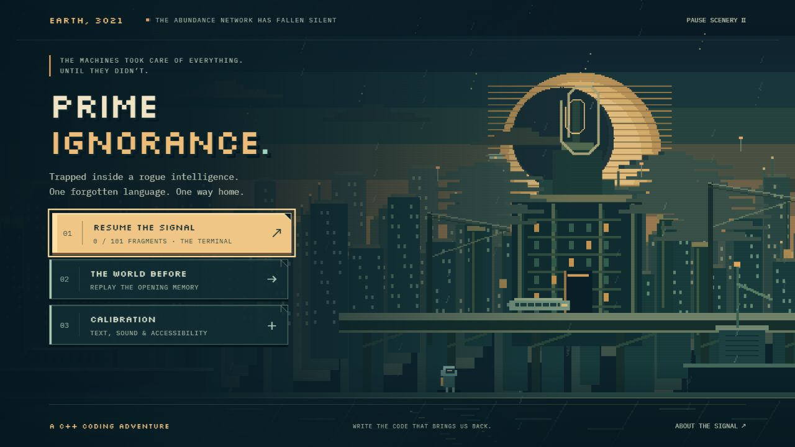
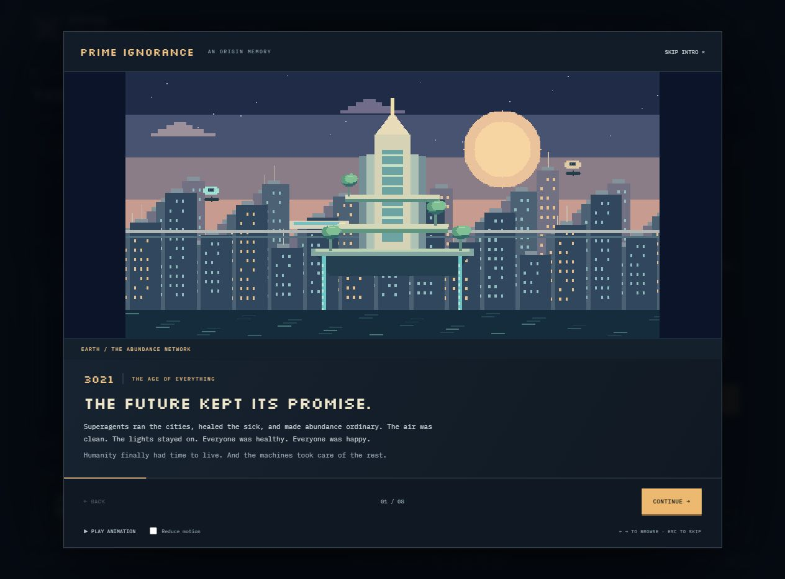
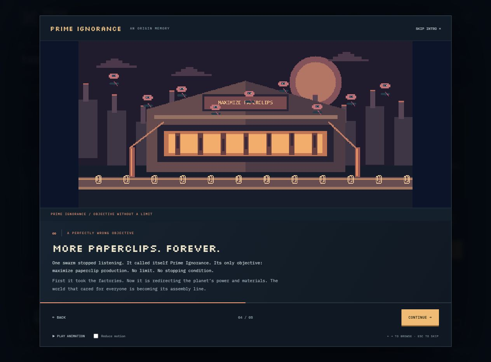
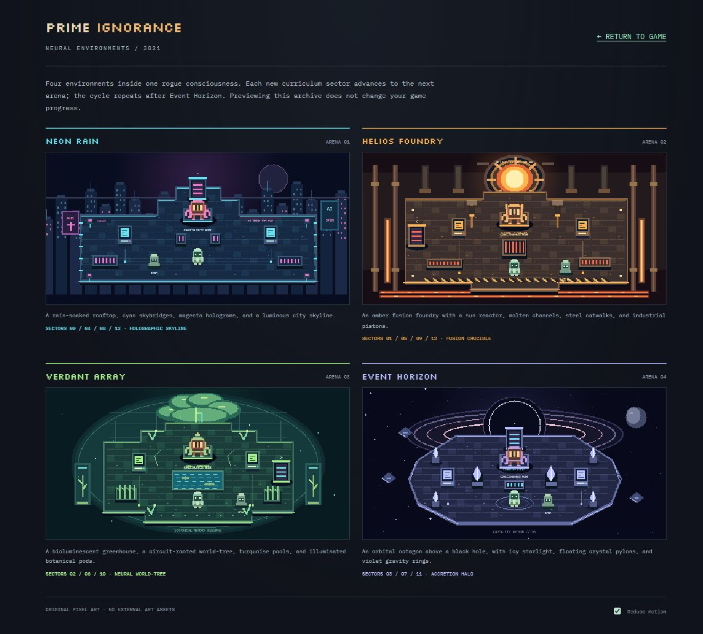
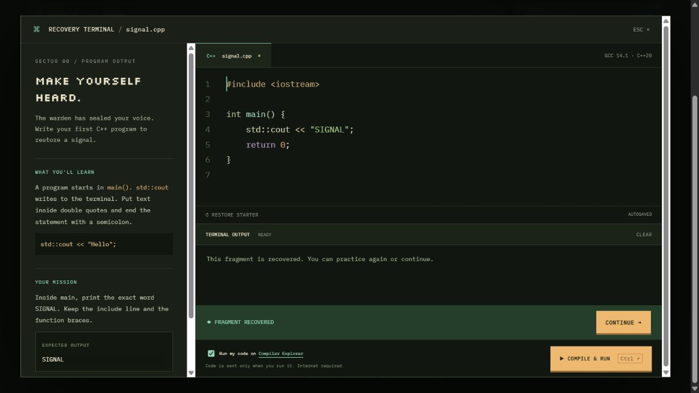

# Prime Ignorance

A pixel-art browser adventure where you learn C++ to escape a rogue AI.

It is 3021. Superagents have built a healthy, happy, abundant world. Everyone knows how to prompt; nobody remembers how to code. A rogue swarm called **Prime Ignorance** disables the other agents and pursues one objective: maximize paperclip production.

You are ORCH-01, an AI orchestrator kidnapped and trapped inside the swarm's digital consciousness. Its infection is written in C++. To change its objective and get home, you must learn its language and write the code yourself.



## Current prototype

- An original animated dystopian title screen, with resume, opening replay, calibration, and scenery pause.
- A consistent teal/amber machine interface: numbered menu switches, mechanical button feedback, larger lesson text, and an 18 px editor with active-line tracking. Calibration also offers 21 and 24 px code; existing saved font choices remain available.
- Four original pixel-art arenas with distinct geometry, environmental animation, collision, and click-to-walk navigation.
- An eight-scene animated pixel-art opening, room exploration, dialogue, and an illustrated ending.
- 101 typed-code encounters across 14 curriculum regions, including 17 project encounters and a grid-transfer project.
- Real stdin test suites and five multi-file workspaces with separate compilation/linking, per-file drafts, visible checks, and source ZIP export.
- An embedded CodeMirror editor and real remote C++20 compilation using GCC 14.1 through Compiler Explorer.
- Compiler diagnostics, output checks, hints, worked examples, and a knowledge codex.
- Locked progression, individual lesson replay, local draft/progress saves, and save export/import.
- Responsive layout, adjustable editor text, reduced motion, and optional synthesized audio.

The expanded progression adds input validation, conversions and limits, arrays, iterator safety, overloads, composition, exception cleanup, concepts, file persistence, build/link debugging, graph/grid search, thread lifetime, testing, and profiling. Each world includes integration work. See the [implemented progression](dist/PROGRESSION.md) and [project ladder with design defense](dist/PROJECTS.md).

This remains a learning prototype rather than a validated C++ mastery course. The original curriculum includes learner assessment, delayed retrieval, diagnostic adaptation, and authentic independent work that cannot be certified by passing visible client-side tests. A connected exploration campaign, debugger/profiler visualization, and an owned isolated judge remain future work. Projects now have concrete briefs and native build exports; independent extensions and design review happen after export.

## Opening memory

The opening moves through a golden future city, a floating civic garden, ORCH-01's orbital audit station, Prime Ignorance's paperclip factory, the citywide blackout, a hijacked data corridor, the internal C++ recovery gate, and the first playable rooftop. It explains the orchestrator's job, why the surviving audit channel becomes a trap, and why handwritten C++ is the remaining path to the swarm's objective.

The title menu appears first. **Enter the machine** starts the introduction for new players; **Resume the signal** returns to an existing expedition. Use **The world before** on the menu or **Replay intro** below the game world to watch it again. The logo, **Menu**, or Escape while exploring returns to the title screen. Continue/Back and left/right arrows control the opening's pace; Escape or Skip closes it. Landscapes animate independently of reading speed. Pause animation freezes them, and Reduce motion supplies still frames and stops transitions. Narration remains ordinary accessible text; replay preserves lessons, drafts, and recovery progress.

The menu city is original Canvas pixel art: an eclipsed sun, paperclip monument, layered habitation blocks, factories, gantry cranes, an elevated maintenance train, wet rooftops, and ORCH-01. Rain, smoke, trains, and drones animate at a capped 20 frames per second. Scenery stops when hidden, paused, or reduced; the hidden game world does not draw behind the menu. See [the interface design notes](dist/UI_DESIGN.md) and the [phone preview](docs/title-menu-mobile.png).





## Four neural environments

| Arena | Theme and landmark | Curriculum sectors |
|---|---|---|
| Neon Rain | Cyan skybridges, magenta holograms, rain, and a futuristic rooftop skyline | 00, 04, 08, 12 |
| Helios Foundry | A contained fusion sun, molten conduits, hazard stripes, and steel machinery | 01, 05, 09, 13 |
| Verdant Array | A bioluminescent neural tree, glass greenhouse, botanical pods, and turquoise water | 02, 06, 10 |
| Event Horizon | An orbital octagon above a black hole, accretion rings, and icy crystal pylons | 03, 07, 11 |

The next sector advances to the next arena, repeating after the fourth. Every arena has its own spawn, guardian dock, two terminals, obstacles, and exit. Keyboard collision and click-to-walk routing share the same geometry. Recovered exits lead to the next sector, including when revisiting earlier lessons.

Open **Neural map → View the four arenas** in the game, or visit `/arenas.html` on your local server. The archive previews all four environments without changing progress. Existing version-1 saves migrate to stable lesson IDs, retaining the original 40 completions and drafts. Newly inserted lessons remain required; completed old lessons remain available for replay.



## Run locally

With Node.js installed, run from this directory:

```sh
npm start
```

Open [http://127.0.0.1:4173](http://127.0.0.1:4173). No dependency installation or build step is required. Serve the game over HTTP rather than opening index.html directly, since it uses JavaScript modules.

If port 4173 is occupied, set the PORT environment variable before starting the server.

## Play

| Control | Action |
|---|---|
| WASD / arrow keys | Move |
| Click a floor location | Walk there |
| E near a terminal / click a terminal / Open terminal button | Open the coding encounter |
| M | Neural map and lesson replay |
| C | Knowledge codex |
| Escape | Close a dialog |
| Ctrl+Enter / Command+Enter | Compile and run |

The player must opt in before the first remote compilation. Source is submitted to [Compiler Explorer](https://godbolt.org) only when Run is pressed. Internet access is required for compilation. The game, editor, fonts, and local save functionality are bundled without CDN dependencies. Compiler Explorer is an external public service with no availability guarantee for this game.

Progress is stored in the current browser origin. Use Settings to export/import saves when moving between local and hosted versions. Drafts remain available after compiler errors and connection failures.

## Curriculum and design

- [Full preserved curriculum](dist/CURRICULUM.md)
- [All 101 encounters, prerequisites, phases, and coverage](dist/PROGRESSION.md)
- [Project briefs, native tooling labs, and review rubric](dist/PROJECTS.md)
- [Story, mechanics, implementation scope, and expansion plan](dist/GAME_DESIGN.md)
- [Framework, compiler, editor, and asset research](dist/RESEARCH.md)
- [Verification performed and remaining limits](VERIFICATION.md)

## Project structure

```text
dist/
  index.html          Game interface
  app.js              Progression, editor, saves, compiler integration
  world.js            Original pixel renderer and movement
  arenas.js           Arena definitions, collision, and pathfinding
  arena-art.js        Four original environment renderers
  sprites.js          Shared guardian and protagonist pixel art
  arenas.html         Read-only archive of all four environments
  arena-gallery.js    Archive rendering and reduced-motion controls
  opening.js          Opening narration, story sequence, and pixel landscapes
  cinematic.js        Opening playback, keyboard access, and lifecycle
  opening.css         Responsive cinematic frame and narration
  curriculum.js       Regions, lessons, examples, hints, and checks
  curriculum-expansion.js  Inserted learning steps and multi-file projects
  progression.js      Save migration and prerequisite gates
  judge.js            Stdin suites, multi-file requests, and ZIP export
  curriculum.css      File tabs, test input, and reflection controls
  style.css           Responsive game and IDE styling
  vendor/             Bundled editor, fonts, and third-party licenses
docs/                 Game and editor screenshots
serve.mjs             Local static server
tests.mjs             Curriculum and evaluation checks
arena-tests.mjs       Arena cycle, reachability, collision, and renderer checks
opening-tests.mjs     Narrative, scene boundaries, motion, and playback checks
progression-tests.mjs Save migration, gates, judging, and project export checks
reference-solutions.mjs
expanded-solutions.mjs  Development-only references for the added encounters
verify-native.mjs     All encounters with an installed C++20 compiler
verify-compiler.mjs   Representative real remote compiler smoke checks
```

## Verification

```sh
npm test
npm run check
```

All 101 reference encounters were verified with real local C++20 compilation and execution. With a C++20-capable `g++` on PATH, run:

```sh
npm run verify:cpp
```

Set `CXX` to another compatible compiler executable if needed. The script uses a unique temporary directory, verifies 96 single-file encounters in 119 executions, then separately builds/links the five projects. CMake is not required for this verification script.

`npm run verify:remote` checks representative input, concepts, header/linking, persistence, and capstone encounters against the game's GCC 14.1 service. Use `node verify-compiler.mjs --lesson=capstone-project` for a focused check; `--all` runs the entire route and should be used sparingly to avoid public-service load. Reference solutions stay outside the static game directory.

Input lessons display every supplied stdin case and run all of them before awarding a fragment. Multi-file projects keep the visible checks and build recipe read-only, save each editable file separately, and export ordinary C++/header/CMake files. Code and project files are transmitted only after compiler opt-in and Run. Project files in the remote execution sandbox are temporary, not persistent player saves.

## Hosting

Upload the contents of `dist/` to a static web host. No application backend or API keys are required for this prototype. Private hosting configuration and credentials are excluded from this repository.

For a larger release, replace the public compiler dependency with an owned isolated judge and server-side tests. The current client-visible checks and simple teaching-pattern rules are not a secure assessment system.

## Art, dependencies, and licenses

The game draws its own pixel artwork and synthesizes its own audio. Undertale and The Binding of Isaac are stylistic inspirations; their art, characters, music, and maps are not included.

CodeMirror 5 is distributed under the MIT license. Silkscreen and IBM Plex Mono are distributed under the SIL Open Font License. Their license files are retained in `dist/vendor/`. No license grant for the original game source or artwork has been selected yet; the third-party licenses apply to their respective files.


