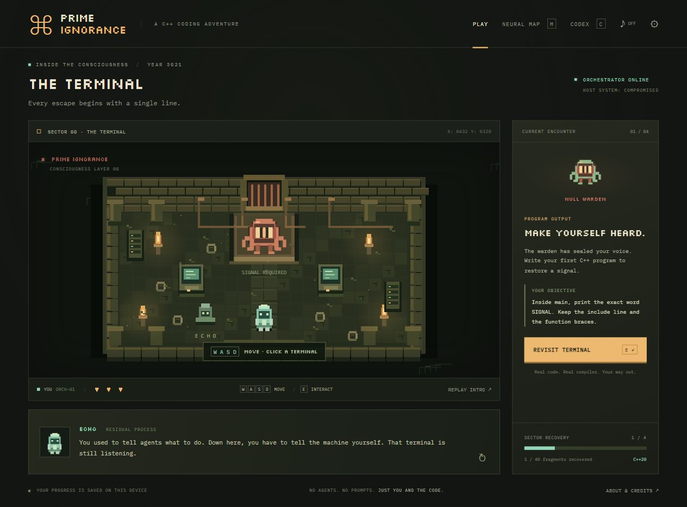
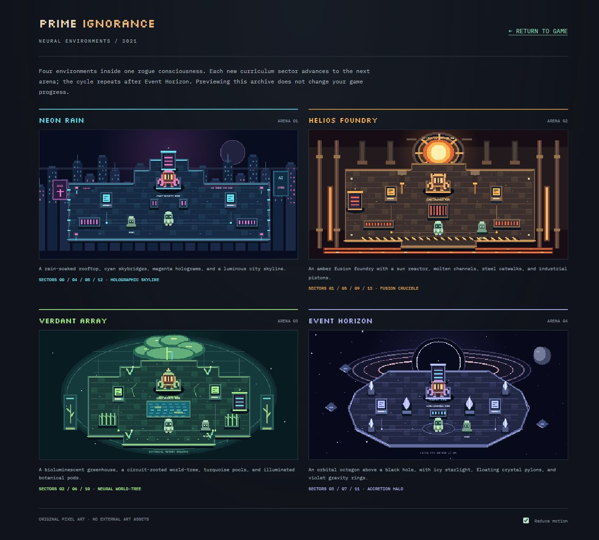
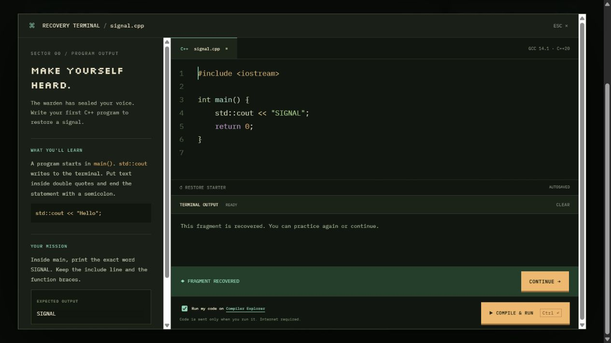

# Prime Ignorance

A pixel-art browser adventure where you learn C++ to escape a rogue AI.

It is 3021. Superagents have built a healthy, happy, abundant world. Everyone knows how to prompt; nobody remembers how to code. A rogue swarm called **Prime Ignorance** disables the other agents and pursues one objective: maximize paperclip production.

You are ORCH-01, an AI orchestrator kidnapped and trapped inside the swarm's digital consciousness. Its infection is written in C++. To change its objective and get home, you must learn its language and write the code yourself.



## Current prototype

- Four original pixel-art arenas with distinct geometry, environmental animation, collision, and click-to-walk navigation.
- Room exploration, dialogue, opening story, and ending.
- 40 typed-code encounters organized into 14 curriculum regions.
- An embedded CodeMirror editor and real remote C++20 compilation using GCC 14.1 through Compiler Explorer.
- Compiler diagnostics, output checks, hints, worked examples, and a knowledge codex.
- Locked progression, individual lesson replay, local draft/progress saves, and save export/import.
- Responsive layout, adjustable editor text, reduced motion, and optional synthesized audio.

This is a playable prototype, not a complete adventure campaign or a C++ mastery course. Four arena layouts cycle by curriculum sector; advanced topics are introductory slices. Adaptive assessment, spaced practice, a connected exploration campaign, debugger visualizations, and substantial projects remain future work. See [game design](dist/GAME_DESIGN.md) for the gaps and progression plan.

## Four neural environments

| Arena | Theme and landmark | Curriculum sectors |
|---|---|---|
| Neon Rain | Cyan skybridges, magenta holograms, rain, and a futuristic rooftop skyline | 00, 04, 08, 12 |
| Helios Foundry | A contained fusion sun, molten conduits, hazard stripes, and steel machinery | 01, 05, 09, 13 |
| Verdant Array | A bioluminescent neural tree, glass greenhouse, botanical pods, and turquoise water | 02, 06, 10 |
| Event Horizon | An orbital octagon above a black hole, accretion rings, and icy crystal pylons | 03, 07, 11 |

The next sector advances to the next arena, repeating after the fourth. Every arena has its own spawn, guardian dock, two terminals, obstacles, and exit. Keyboard collision and click-to-walk routing share the same geometry. Recovered exits lead to the next sector, including when revisiting earlier lessons.

Open **Neural map → View the four arenas** in the game, or visit `/arenas.html` on your local server. The archive previews all four environments without changing progress. Existing saves and all 40 C++ encounters remain compatible.



## Run locally

With Node.js installed, run from this directory:

```sh
npm start
```

Open [http://127.0.0.1:4173](http://127.0.0.1:4173). No dependency installation or build step is required. Serve the game over HTTP rather than opening index.html directly, since it uses JavaScript modules.

If port 4173 is occupied, set the PORT environment variable before starting the server.

## Play

| Control | Action |
|---|---|
| WASD / arrow keys | Move |
| Click a floor location | Walk there |
| E near a terminal / click a terminal / Open terminal button | Open the coding encounter |
| M | Neural map and lesson replay |
| C | Knowledge codex |
| Escape | Close a dialog |
| Ctrl+Enter / Command+Enter | Compile and run |

The player must opt in before the first remote compilation. Source is submitted to [Compiler Explorer](https://godbolt.org) only when Run is pressed. Internet access is required for compilation. The game, editor, fonts, and local save functionality are bundled without CDN dependencies. Compiler Explorer is an external public service with no availability guarantee for this game.

Progress is stored in the current browser origin. Use Settings to export/import saves when moving between local and hosted versions. Drafts remain available after compiler errors and connection failures.

## Curriculum and design

- [Full preserved curriculum](dist/CURRICULUM.md)
- [Story, mechanics, implementation scope, and expansion plan](dist/GAME_DESIGN.md)
- [Framework, compiler, editor, and asset research](dist/RESEARCH.md)
- [Verification performed and remaining limits](VERIFICATION.md)

## Project structure

```text
dist/
  index.html          Game interface
  app.js              Progression, editor, saves, compiler integration
  world.js            Original pixel renderer and movement
  arenas.js           Arena definitions, collision, and pathfinding
  arena-art.js        Four original environment renderers
  sprites.js          Shared guardian and protagonist pixel art
  arenas.html         Read-only archive of all four environments
  arena-gallery.js    Archive rendering and reduced-motion controls
  curriculum.js       Regions, lessons, examples, hints, and checks
  style.css           Responsive game and IDE styling
  vendor/             Bundled editor, fonts, and third-party licenses
docs/                 Game and editor screenshots
serve.mjs             Local static server
tests.mjs             Curriculum and evaluation checks
arena-tests.mjs       Arena cycle, reachability, collision, and renderer checks
reference-solutions.mjs
verify-compiler.mjs   Real compiler verification script
```

## Verification

```sh
npm test
npm run check
```

All 40 reference solutions were also verified against the real compiler. To repeat that check, run:

```sh
node verify-compiler.mjs
```

The script batches solutions into one request to reduce public-service load. Use it sparingly. Reference solutions are included for development and content verification; they are outside the static game directory.

## Hosting

Upload the contents of `dist/` to a static web host. No application backend or API keys are required for this prototype. Private hosting configuration and credentials are excluded from this repository.

For a larger release, replace the public compiler dependency with an owned isolated judge and server-side tests. The current client-visible checks and simple teaching-pattern rules are not a secure assessment system.

## Art, dependencies, and licenses

The game draws its own pixel artwork and synthesizes its own audio. Undertale and The Binding of Isaac are stylistic inspirations; their art, characters, music, and maps are not included.

CodeMirror 5 is distributed under the MIT license. Silkscreen and IBM Plex Mono are distributed under the SIL Open Font License. Their license files are retained in `dist/vendor/`. No license grant for the original game source or artwork has been selected yet; the third-party licenses apply to their respective files.


